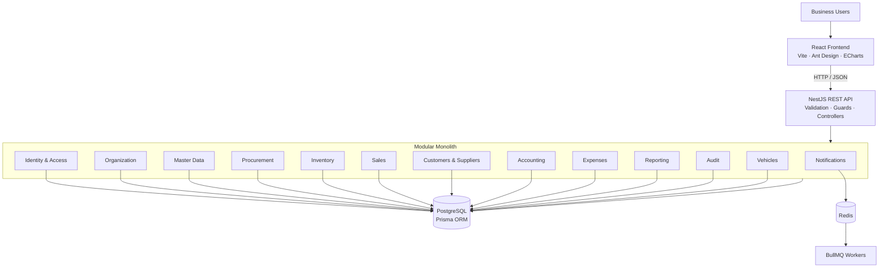
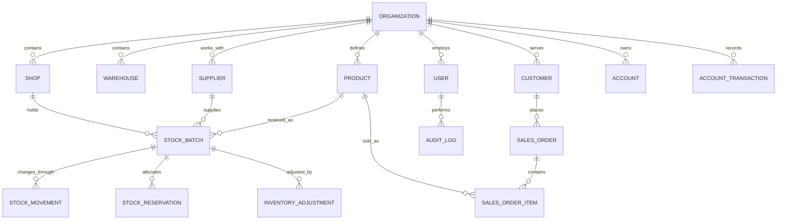

# Manager ERP

### An Operations and Inventory Management System for Perishable-Goods Wholesale and Retail Businesses

Manager ERP is a full-stack enterprise resource planning application designed around the operational realities of a perishable-goods business: purchasing stock from suppliers, receiving and tracking individual batches, selling to retail customers and business buyers, managing customer credit, recording financial activity, and maintaining visibility across business locations.

The project focuses on connecting operational workflows that are often handled separately in small and medium-sized wholesale and retail businesses. Instead of treating procurement, inventory, sales, and accounting as isolated CRUD modules, the system models how a business transaction affects stock, customer balances, suppliers, and financial records.

It is built using a **NestJS modular monolith, PostgreSQL, Prisma ORM, Redis, BullMQ, and React**.

---

## Table of Contents

- [Business Problem](#business-problem)
- [Core Capabilities](#core-capabilities)
- [End-to-End Business Workflows](#end-to-end-business-workflows)
- [System Architecture](#system-architecture)
- [Backend Module Design](#backend-module-design)
- [Inventory and Data Consistency](#inventory-and-data-consistency)
- [Database and Domain Model](#database-and-domain-model)
- [Authentication and Authorization](#authentication-and-authorization)
- [Frontend Architecture](#frontend-architecture)
- [Technology Stack](#technology-stack)
- [Repository Structure](#repository-structure)
- [Getting Started](#getting-started)
- [Configuration](#configuration)
- [Development Commands](#development-commands)
- [API Documentation](#api-documentation)
- [Engineering Decisions](#engineering-decisions)
- [Implementation Scope and Limitations](#implementation-scope-and-limitations)
- [Project Documentation](#project-documentation)

---

## Business Problem

Perishable-goods businesses operate with constraints that conventional inventory applications do not always address well.

A vegetable wholesale and retail operation, for example, must manage:

- Stock arriving from multiple suppliers at different purchase prices.
- Individual batches with different quantities, grades, and shelf-life considerations.
- Products sold using different units and quantities.
- Retail sales alongside recurring business-to-business orders.
- Customer credit, partial payments, and outstanding balances.
- Damaged, spoiled, adjusted, or otherwise unavailable stock.
- Supplier obligations, operating expenses, and cash movement.
- The need to understand what was purchased, sold, adjusted, and left in stock.

When these activities are recorded independently, it becomes difficult to reconcile actual stock with sales, understand product-level margins, and determine the financial position of the business.

Manager ERP is designed to bring these operational records into one application with a shared data model and clear boundaries between business domains.

**The central design principle:** a business operation should not be considered complete merely because a record was created. Its effects on related business entities must also be accounted for consistently.

---

## Core Capabilities

The repository contains a NestJS backend with domain modules, a Prisma/PostgreSQL data model, and a React application.

| Domain | Purpose |
|---|---|
| Organization management | Represent organizations, shops, warehouses, and branches |
| Identity and access management | Users, roles, permissions, authentication |
| Master data | Product catalogue, categories, units, and product attributes |
| Procurement | Purchase-order and supplier-related workflows |
| Inventory | Batch-level stock, stock movements, reservations, adjustments, and daily snapshots |
| Sales | Sales orders, order lifecycle, and customer-related transactions |
| Customer management | Customer profiles, credit limits, outstanding balances, and ledgers |
| Supplier management | Supplier profiles and supplier-related stock records |
| Accounting | Accounts, financial transactions, and financial reporting |
| Expenses | Expense-related domain models and application area |
| Reporting | Operational and financial reporting components |
| Audit | Audit-log domain and mutation traceability |
| Notifications | Notification infrastructure and BullMQ integration |
| Vehicles | Vehicle and trip-related domain models |

The implementation status of individual modules varies. The [backend source tree](backend/src/modules) and [Prisma schema](backend/prisma/schema.prisma) are the best places to inspect the current implementation.

---

## End-to-End Business Workflows

The following workflows explain how the system is intended to connect business activities. They describe the domain behavior and relationships represented in the project; they should not be interpreted as a claim that every possible workflow edge case is production-complete.

### 1. Procurement and stock receiving

A purchase begins with the requirement to replenish inventory.

A typical flow is:

1. Select an existing supplier.
2. Create a purchase order and add products and quantities.
3. Record purchase prices and the relevant commercial details.
4. Receive the purchased goods.
5. Create or update stock batches for the received products.
6. Record the stock movement associated with receipt.
7. Make the received quantity available for subsequent operations.

A batch is important because the same product can be purchased at different costs and received at different times.

For example, purchasing tomatoes on two different days should not force the business to treat both deliveries as one undifferentiated quantity. The received batches can retain their own purchase price, quantity, supplier reference, and other batch attributes.

Relevant areas: `procurement`, `suppliers`, `inventory`, and `accounting`.

### 2. Batch-level inventory management

Inventory is modeled around stock batches rather than only maintaining a single quantity on the product catalogue.

A stock batch contains information such as:

- Product and organization.
- Shop association where applicable.
- Batch identifier.
- Received date and optional expiry date.
- Supplier reference.
- Purchase and selling prices.
- Received, available, reserved, and damaged quantities.
- Unit cost, grade, and storage location.
- Batch status and optimistic-locking version.

Stock movements provide a separate record of inventory activity, including receipt, sale, reservation, release, adjustment, transfer, write-off, and return movement types.

This separation makes it possible to distinguish the current quantity from the history of how that quantity changed.

The inventory model also includes reservations, adjustments, and daily stock snapshots.

### 3. Sales and order processing

The sales domain represents customer orders and their lifecycle.

The data model includes order states such as:

`DRAFT → CONFIRMED → PROCESSING → SHIPPED → DELIVERED`

It also models cancellation and return states.

Sales orders are connected to customers, users, and order items. Inventory batches and reservations provide the stock-side context for fulfilling demand.

This domain is particularly relevant to businesses that handle both direct retail transactions and larger customer orders.

### 4. Customer credit and collections

A customer record can contain:

- Contact and business details.
- GSTIN where applicable.
- Credit limit.
- Outstanding balance.
- Associated sales orders.
- Customer ledger entries.

The purpose of separating customer information from ledger activity is to retain a financial history rather than relying only on a mutable balance field.

A credit sale and a subsequent payment are different business events. Their relationship must remain traceable so that the business can understand what is owed and how it changed.

### 5. Accounting and financial visibility

The accounting domain contains account definitions and financial transaction records.

The data model uses account types such as:

- Assets
- Liabilities
- Equity
- Income
- Expenses

It also represents debit and credit transaction types.

The accounting area includes account management, transaction services, and reporting services. Its purpose is to provide a financial view that can be connected to the operational events recorded elsewhere in the system.

Financial reports should be interpreted in the context of the underlying transaction records and configured business rules. This repository should not be treated as a substitute for a verified statutory accounting or tax-compliance system.

### 6. Operational adjustments and daily visibility

Perishable inventory changes for reasons other than sales.

The inventory domain therefore represents adjustments and daily stock snapshots. These structures are useful for comparing opening stock, received quantities, sold quantities, adjustments, and closing stock.

They also provide a foundation for investigating differences between expected stock and physical stock.

---

## System Architecture

Manager ERP uses a **modular monolith** architecture.

The backend is deployed as one NestJS application, while internal modules separate responsibilities by business domain. Modules communicate through application services and dependency injection rather than requiring a network call between every business capability.

This is an intentional choice for a business application whose core workflows need reliable transactions across related records.

### High-level architecture



### Request lifecycle

A typical API request follows this path:

1. The React application sends an HTTP request through the shared API client.
2. NestJS receives the request through a controller.
3. Authentication and authorization components validate access where required.
4. Transport-level validation checks the incoming data.
5. The controller delegates business operations to an application service.
6. The application service applies domain rules and interacts with Prisma.
7. PostgreSQL persists the relevant changes, using transactions where required by the operation.
8. The API returns a structured response to the frontend.

The controller layer is responsible for HTTP concerns; business operations belong in the application/service layer. This separation keeps transport details from becoming the business logic itself.

### Why a modular monolith?

For this project, the modular monolith provides:

- One application to develop and deploy.
- Direct service calls within the application.
- A shared transactional boundary for related operational changes.
- Explicit ownership of business logic by modules.
- Fewer operational components than an early microservices architecture.

The application can evolve into independently deployed services later if actual scaling, team ownership, or availability requirements justify that change. Microservices and Kubernetes are not architectural goals by themselves.

---

## Backend Module Design

The backend is organized using NestJS modules, controllers, and application services.

The most important domain areas are described below.

### Identity and Access Management — `iam`

Responsible for user authentication and permission management.

The module includes:

- Authentication service and controller.
- User management service and controller.
- Role management service and controller.
- User-role associations.
- Resource/action permission definitions.

Roles are associated with permissions, and users can be associated with roles. The permission model supports resource/action combinations instead of relying only on a fixed list of user types.

### Organization — `organization`

Represents the organizational structure.

The Prisma model includes organizations, shops, warehouses, and branches. This allows records to be associated with a business organization and its operating locations.

### Master Data — `masterdata`

Maintains reusable business definitions such as products, units, and categories.

Products are associated with an organization, category, and unit. Product records can also carry SKU, barcode, HSN code, tax rate, and stock-level metadata.

Keeping product definitions separate from stock batches prevents catalogue information from being confused with physical inventory.

### Procurement — `procurement`

Owns purchasing-related application logic and API endpoints.

It connects supplier and purchase-order concepts with the inventory receiving process.

### Inventory — `inventory`

Owns the stock-related operations and data structures.

It contains an application service and controller, as well as entities for:

- Stock batches.
- Stock movements.
- Stock reservations.
- Inventory adjustments.
- Daily stock snapshots.

This module is central to the ERP because stock state is affected by multiple business operations.

### Sales — `sales`

Owns sales-order application logic and its HTTP interface.

Sales orders are associated with customers, users, and order items. Order and payment status are modeled separately, allowing the order lifecycle and payment lifecycle to represent different states.

### Customers and Suppliers

These areas manage business counterparties and the financial or operational relationships attached to them.

Customer records include credit-related attributes and customer ledger relationships. Supplier records are associated with purchasing and supplier-side stock information.

### Accounting — `accounting`

Contains account, transaction, and reporting services.

The module provides a financial representation of business activity using account types and debit/credit transaction types.

### Reporting — `reports`

Provides the reporting domain and its application/infrastructure boundaries.

Reporting is separated from transactional modules so that analytical queries and operational write logic do not become one undifferentiated service.

### Audit — `audit`

Provides the audit domain for traceability of business operations.

Auditability is important in inventory and finance because a final quantity or balance is less useful without the ability to understand the operations that changed it.

### Notifications — `notifications`

Provides the notification module boundary and integrates with the Redis/BullMQ infrastructure used by the backend.

### Expenses and Vehicles

These modules represent additional operational areas in the application structure and data model. Their presence in the architecture should not be mistaken for proof that every associated approval, trip, or reporting workflow is complete.

---

## Inventory and Data Consistency

Inventory is one of the most important engineering concerns in this project.

A naive implementation might store a single `quantity` field on each product and update it whenever a purchase or sale occurs. That approach becomes difficult to reason about when stock comes from different suppliers, has different costs, is reserved for orders, or is partially damaged.

Manager ERP instead models the stock lifecycle using separate batch, movement, reservation, and adjustment records.

### Stock batch versus product

A product describes what the business sells.

A stock batch describes a particular quantity of that product received or held under specific conditions.

This matters because two batches of the same product can have different:

- Acquisition costs.
- Receipt dates.
- Suppliers.
- Expiry dates.
- Grades.
- Available quantities.

The batch is therefore the more useful entity for inventory operations.

### Stock movement history

The schema defines movement types including:

`RECEIVED`, `SOLD`, `RESERVED`, `RELEASED`, `ADJUSTED`, `TRANSFERRED_IN`, `TRANSFERRED_OUT`, `WRITTEN_OFF`, and `RETURNED`.

Each stock movement records the batch, product, quantity, unit cost, total cost, movement type, reference information, and the user responsible.

This provides a historical record of stock changes instead of making the current balance the only source of information.

### Reservations

A reservation associates stock with a business reference, such as an order.

The model records the reserved quantity, fulfilled quantity, and reservation status.

This helps distinguish stock physically available in the system from stock already allocated to a demand.

### Adjustments and stock snapshots

Inventory adjustments retain the previous quantity, new quantity, adjustment type, reason, and user.

Daily stock snapshots represent opening, received, sold, adjusted, and closing quantities for a product and date.

These records help with reconciliation and operational analysis.

### Concurrency considerations

Inventory is vulnerable to race conditions.

For example, two users may attempt to reserve the same batch at nearly the same time. If both requests read the same available quantity before either writes its reservation, the system could over-allocate stock without appropriate concurrency controls.

The project documents concurrency strategies including:

- Optimistic locking through version fields on strategic entities.
- Database transactions for related writes.
- Row-level locking where necessary.
- PostgreSQL advisory-lock design for selected critical operations.

The Prisma schema includes version fields on entities such as stock batches and orders. A version column alone does not guarantee safe concurrency: the service must also perform a conditional update or an equivalent check and handle conflicts.

See [ARCHITECTURE.md](ARCHITECTURE.md) and the concurrency-related database artifacts when reviewing the implementation.

---

## Database and Domain Model

The system uses PostgreSQL as its primary relational database and Prisma as the ORM and schema management layer.

### Database design characteristics

The Prisma schema uses:

- UUID primary keys.
- Explicit foreign-key relationships.
- Organization-scoped records.
- Unique constraints for business identifiers.
- Indexes on commonly queried relationship and filter fields.
- Decimal types for quantities and monetary values.
- Timestamps for record lifecycle information.
- Soft-delete fields on many entity models.
- Version fields on selected records.

Decimal columns are particularly important for this business domain. Inventory quantities may be fractional, and financial values should not rely on binary floating-point arithmetic.

### Important domain relationships



The diagram is a simplified view of selected relationships. The authoritative model is [backend/prisma/schema.prisma](backend/prisma/schema.prisma).

### Domain-driven design documentation

The repository also contains a domain analysis describing bounded contexts, entities, aggregates, and business invariants.

It is useful to read alongside the implementation because it explains why some entities are modeled separately and how business operations are expected to interact.

---

## Authentication and Authorization

The backend includes an Identity and Access Management module.

The technology stack includes:

- JWT-based authentication.
- Passport JWT integration.
- Password hashing with bcrypt.
- Refresh-token-related user state.
- Role and permission entities.
- NestJS guards and decorators in the shared infrastructure.

### Permission model

A permission is represented as a combination of:

- `resource`
- `action`
- `role`

A user can have multiple roles through the user-role relationship.

This makes the permission model extensible. For example, access to a resource can be distinguished by actions such as reading, creating, updating, or deleting, depending on the permissions configured by the application.

**Security note:** the seeded development account and local infrastructure credentials are for local setup only. Replace default credentials, use strong environment-specific secrets, and review authorization behavior before deploying with real business data.

---

## Frontend Architecture

The frontend is a React single-page application built with Vite.

Its main responsibilities are:

- Rendering the business interface.
- Providing navigation between operational modules.
- Collecting and validating user input.
- Sending API requests through the shared Axios client.
- Presenting business records and reporting visualizations.

### Main technologies

- **React 18** for component-based user interfaces.
- **React Router** for client-side navigation.
- **Ant Design 5** for application UI components.
- **Axios** for HTTP requests.
- **Day.js** for date handling.
- **ECharts** and `echarts-for-react` for data visualization.

The frontend is separated from the backend so the API and user interface can be built and deployed independently.

---

## Technology Stack

| Layer | Technology | Responsibility |
|---|---|---|
| Runtime | Node.js 22 | Backend runtime |
| Backend framework | NestJS 11 | Modular API application |
| Language | TypeScript | Backend type safety |
| ORM | Prisma 6 | Relational data access and migrations |
| Database | PostgreSQL 17 | Durable transactional storage |
| Cache / queue infrastructure | Redis 7 | Shared infrastructure for asynchronous processing |
| Job processing | BullMQ 5 | Queue and worker integration |
| Authentication | JWT, Passport, bcryptjs | Authentication and password hashing |
| API documentation | NestJS Swagger | API schema and interactive documentation |
| Validation | class-validator, class-transformer, Zod | Request and data validation |
| Frontend | React 18, Vite 5 | Single-page application |
| UI | Ant Design 5 | Business interface components |
| Charts | Apache ECharts | Reporting visualization |
| Containers | Docker Compose | Local infrastructure |

---

## Repository Structure

```text
Manager-ERP/
│
├── backend/
│   ├── docker/
│   │   ├── Dockerfile
│   │   └── docker-compose.yml
│   │
│   ├── prisma/
│   │   ├── schema.prisma
│   │   ├── migrations/
│   │   └── seed.ts
│   │
│   ├── src/
│   │   ├── common/                 # Shared application infrastructure
│   │   ├── modules/
│   │   │   ├── iam/                # Authentication, users, roles
│   │   │   ├── organization/       # Organization and locations
│   │   │   ├── masterdata/         # Products, units, categories
│   │   │   ├── procurement/        # Purchasing workflows
│   │   │   ├── inventory/          # Batches, movements, reservations
│   │   │   ├── sales/              # Sales orders
│   │   │   ├── customers/          # Customer domain
│   │   │   ├── suppliers/          # Supplier domain
│   │   │   ├── accounting/         # Accounts and transactions
│   │   │   ├── expenses/           # Expense domain
│   │   │   ├── reports/            # Reporting
│   │   │   ├── audit/              # Audit domain
│   │   │   ├── notifications/      # Notification infrastructure
│   │   │   ├── vehicles/           # Vehicle domain
│   │   │   ├── dashboard.controller.ts
│   │   │   └── health.controller.ts
│   │   ├── prisma/                 # Prisma integration
│   │   ├── app.module.ts
│   │   └── main.ts
│   │
│   ├── .env.example
│   ├── package.json
│   └── tsconfig.json
│
├── frontend/
│   ├── src/
│   │   ├── components/             # Reusable UI components
│   │   ├── pages/                  # Application pages
│   │   ├── api.js                  # Shared API client
│   │   ├── App.jsx
│   │   └── main.jsx
│   ├── package.json
│   └── vite.config.js
│
├── ARCHITECTURE.md
├── domain-model.md
├── workflows.md
└── README.md
```

---

## Getting Started

### Prerequisites

Install the following:

- Node.js 22 or later.
- npm.
- Docker Desktop or Docker Engine with Compose.

### 1. Clone the repository

```bash
git clone https://github.com/Nitish-Konamarthi/Manager-ERP.git
cd Manager-ERP
```

### 2. Start PostgreSQL and Redis

```bash
cd backend
docker compose -f docker/docker-compose.yml up -d
```

The Compose configuration starts PostgreSQL 17 and Redis 7 with persistent Docker volumes and service health checks.

### 3. Configure backend environment

Create a local environment file using the example:

```bash
cp .env.example .env
```

Review every value in `.env` and make sure it matches your local infrastructure.

### 4. Install backend dependencies and initialize the database

```bash
npm install
npx prisma generate
npx prisma migrate dev
npx prisma db seed
```

The seed command should be run only against a development database.

### 5. Start the backend

```bash
npm run start:dev
```

### 6. Start the frontend

Open another terminal:

```bash
cd frontend
npm install
npm run dev
```

### Local endpoints

| Service | URL |
|---|---|
| Backend API | `http://localhost:3042` |
| Frontend | `http://localhost:3043` |
| Swagger API documentation | `http://localhost:3042/api/docs` |

The ports above reflect the current project documentation and should be checked against the active environment configuration if changed locally.

---

## Configuration

The backend uses environment variables rather than hard-coded deployment configuration.

Start with [`backend/.env.example`](backend/.env.example).

Typical configuration categories include:

| Variable | Purpose |
|---|---|
| `DATABASE_URL` | PostgreSQL connection string |
| `REDIS_URL` | Redis connection configuration |
| `JWT_SECRET` | Secret used for JWT signing |
| `JWT_EXPIRES_IN` | Access-token lifetime |
| `PORT` | Backend HTTP port |
| `NODE_ENV` | Runtime environment |

Use the exact variable names and defaults in the checked-in `.env.example` as the source of truth. Do not commit `.env` files, production credentials, or real customer data.

---

## Development Commands

Run backend commands from `backend/`.

| Command | Description |
|---|---|
| `npm install` | Install backend dependencies |
| `npm run start:dev` | Start NestJS in watch mode |
| `npm run build` | Compile backend |
| `npm run start:prod` | Start compiled backend |
| `npm run lint` | Run ESLint |
| `npm run test` | Run Jest unit tests |
| `npm run test:e2e` | Run end-to-end tests |
| `npx prisma generate` | Generate Prisma Client |
| `npx prisma migrate dev` | Apply development migrations |
| `npx prisma migrate deploy` | Apply production migrations |
| `npx prisma studio` | Open Prisma Studio |

Run frontend commands from `frontend/`.

| Command | Description |
|---|---|
| `npm install` | Install frontend dependencies |
| `npm run dev` | Start Vite development server |
| `npm run build` | Build production assets |
| `npm run preview` | Preview the production build locally |

---

## API Documentation

The backend uses NestJS Swagger.

When the backend is running, visit:

```text
http://localhost:3042/api/docs
```

The Swagger interface is the best place to inspect the currently registered API endpoints, request DTOs, response structures, and available operations.

---

## Engineering Decisions

### 1. Modular monolith instead of premature microservices

The business workflows involve related writes across inventory, orders, and financial records.

A modular monolith allows those operations to share application and database transaction boundaries without introducing distributed transaction complexity prematurely.

### 2. Batch-level inventory

Stock batches retain acquisition and quantity information independently. This is more appropriate for perishable products than relying only on a product-level stock number.

### 3. Relational modeling with PostgreSQL

The domain contains relationships that benefit from relational constraints: products belong to organizations, batches refer to products, movements refer to batches, and orders refer to customers.

PostgreSQL provides transactions, constraints, indexes, and locking primitives for these requirements.

### 4. Prisma as the persistence layer

Prisma provides typed access to the relational schema and a migration workflow. The schema acts as a central reference for entity relationships and database constraints.

### 5. Explicit workflow and domain documentation

The project includes separate architecture, domain-model, and workflow documents.

This is deliberate: business requirements, domain invariants, and implementation structure should be reviewable independently rather than being hidden inside controllers.

### 6. Concurrency is a domain concern

Inventory is shared state. A stock reservation or sale can conflict with another operation. The project therefore treats transaction design and concurrency control as first-class concerns rather than assuming that a simple read-modify-write sequence is sufficient.

---

## Implementation Scope and Limitations

This repository is an evolving business application, not a claim of a fully audited, production-certified ERP deployment.

A few distinctions are important:

- The current codebase has a real NestJS backend, React frontend, Prisma schema, and PostgreSQL/Redis development infrastructure.
- The repository contains application services and controllers for important areas such as inventory, sales, procurement, IAM, and accounting.
- Some modules currently have a smaller implementation footprint than the breadth of their domain models or module names might suggest.
- The domain and workflow documents describe broader business behavior and future design considerations. Not every documented workflow should be assumed to be fully implemented.
- Redis and BullMQ dependencies are present, but their presence alone does not prove that every notification or background-processing workflow is active.
- The project should undergo additional integration, concurrency, authorization, backup/restore, and operational testing before handling production financial or inventory records.
- Tax, statutory accounting, and business-specific compliance behavior require independent validation before real-world use.

These boundaries are stated intentionally so reviewers can distinguish implemented software from architectural direction.

---

## Project Documentation

The repository includes additional technical documentation for reviewers and contributors.

| Document | What it explains |
|---|---|
| [Architecture](ARCHITECTURE.md) | Stack, modular boundaries, persistence strategy, and design principles |
| [Domain Model](domain-model.md) | Domain entities, relationships, bounded contexts, aggregates, and business invariants |
| [Business Workflows](workflows.md) | Business process flows and diagrams |
| [Prisma Schema](backend/prisma/schema.prisma) | Concrete relational data model |
| [Backend Source](backend/src) | NestJS modules, controllers, and application services |
| [Frontend Source](frontend/src) | React application and API client |
| [Backend Package](backend/package.json) | Backend dependencies and development scripts |
| [Frontend Package](frontend/package.json) | Frontend dependencies and scripts |
| [Docker Compose](backend/docker/docker-compose.yml) | Local PostgreSQL and Redis infrastructure |
| [Environment Example](backend/.env.example) | Backend configuration template |

---

## Project Motivation

Manager ERP was built to explore how software engineering principles can solve operational problems in a real wholesale and retail business context.

The project brings together backend application design, relational data modeling, inventory lifecycle management, authentication and authorization, financial records, and transaction consistency.

The most interesting engineering challenge is not simply creating forms for products or sales. It is ensuring that business operations remain connected: a purchase affects inventory, a reservation affects available stock, a sale changes stock and customer obligations, and financial activity must remain traceable.

That is the problem this project is designed to address.

---

## Maintainer

**Konamarthi Nitish Veera Venkatesh**

Computer Science graduate interested in backend engineering, cloud infrastructure, distributed systems, and building practical software for real business workflows.

- GitHub: [Nitish-Konamarthi](https://github.com/Nitish-Konamarthi)

---

<p align="center">
  Built to bring operational visibility and engineering discipline to perishable-goods businesses.
</p>
